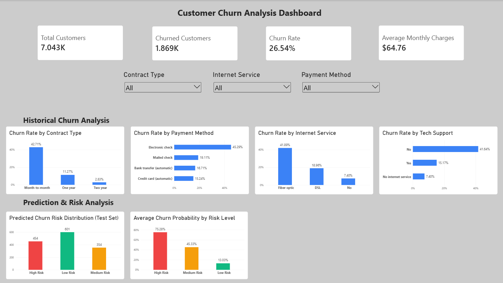

# Customer Churn Analysis & Prediction

## Project Overview

This project analyzes customer churn using the IBM Telco Customer Churn dataset.

The objective is to understand customer churn patterns, identify customer segments associated with higher churn rates, and develop machine-learning models to predict customer churn.

The project combines Python, SQL, machine learning, and Power BI to transform customer data into actionable business insights.

## Project Objectives

1. Clean and prepare customer data for analysis.
2. Explore customer behavior and identify patterns associated with churn.
3. Analyze churn across contract types, internet services, payment methods, and customer tenure.
4. Build and evaluate machine-learning models for churn prediction.
5. Identify customer groups with higher predicted churn risk.
6. Develop an interactive Power BI dashboard to communicate findings.

## Technologies Used

- **Python:** Pandas, NumPy, Matplotlib, Scikit-learn
- **SQL:** MySQL
- **Business Intelligence:** Microsoft Power BI
- **Development Environment:** Visual Studio Code and Jupyter Notebook
- **Version Control:** Git and GitHub (planned)

## Dataset

**Dataset:** IBM Telco Customer Churn

- Total customers: 7,043
- Total features and target columns: 21
- Churned customers: 1,869
- Overall churn rate: 26.54%

The dataset includes customer demographics, account information, subscribed services, contract details, payment methods, and churn status.
## Data Cleaning and Preparation

The dataset contains 7,043 customer records and 21 columns.

The following data preparation steps were performed using Python and Pandas:

1. Examined the dataset structure, column names, and data types.
2. Checked for missing values and duplicate records.
3. Identified blank values in the `TotalCharges` column.
4. Converted `TotalCharges` from text to a numeric data type.
5. Replaced blank `TotalCharges` values with `0` for 11 customers whose tenure was 0 months.
6. Verified that the cleaned dataset contained no missing values or duplicate customer IDs.
7. Exported the cleaned dataset to CSV for SQL analysis and Power BI reporting.

The cleaned dataset contains **7,043 customer records and 21 columns**.

## Exploratory Data Analysis (EDA)

Exploratory data analysis was conducted to investigate customer churn patterns across customer accounts, subscribed services, and payment methods.

### Key Findings

| Analysis Area | Finding |
|---|---|
| Overall Churn | 26.54% of customers churned. |
| Contract Type | Month-to-month customers had the highest churn rate at 42.71%. |
| Internet Service | Fiber optic customers had a churn rate of 41.89%. |
| Technical Support | Customers without technical support had a churn rate of 41.64%. |
| Payment Method | Electronic check customers had a churn rate of 45.29%. |
| Customer Tenure | Customers who churned had an average tenure of approximately 18 months, compared with 38 months for customers who stayed. |
| High-Churn Segment | Month-to-month customers using fiber optic internet and electronic checks had a churn rate of 60.37%. |

### Business Interpretation

The analysis identified several customer segments associated with higher churn rates.

Customers on month-to-month contracts, customers using electronic checks, and customers without technical support showed relatively high churn rates.

Shorter customer tenure was also associated with churn.

These findings can help a telecommunications company identify customer groups that may benefit from targeted retention initiatives.

**Note:** These findings describe associations in the dataset and do not establish that any particular service, contract type, or payment method causes customer churn.

## Machine Learning — Customer Churn Prediction

### Objective

The machine-learning objective was to predict whether a customer would churn based on their account information, subscribed services, contract details, and payment behavior.

The target variable was `Churn`, encoded as:

- `0` — Customer did not churn
- `1` — Customer churned

The `customerID` column was excluded from the model features because it is a unique identifier rather than a meaningful predictive variable.

### Data Preprocessing

The dataset was divided into training and testing sets using an **80:20 stratified split**, with `random_state=42`.

- Training samples: 5,634
- Testing samples: 1,409

Categorical features were transformed using One-Hot Encoding, while numerical features were standardized using StandardScaler.

Preprocessing was performed within the machine-learning workflow to avoid data leakage between the training and testing sets.

### Models Developed

Three model configurations were evaluated:

1. **Logistic Regression** — A linear classification model used as an interpretable baseline.
2. **Original Random Forest** — An ensemble classification model trained using multiple decision trees.
3. **Tuned Random Forest** — A Random Forest model optimized using GridSearchCV with cross-validation.

### Model Performance Comparison

| Model | Accuracy | Precision | Recall | F1-Score | ROC-AUC |
|---|---:|---:|---:|---:|---:|
| Logistic Regression | 80.70% | 66.04% | 56.15% | 60.69% | 0.8422 |
| Original Random Forest | 77.36% | 56.35% | 65.24% | 60.47% | 0.8240 |
| Tuned Random Forest | 75.16% | 52.09% | 79.95% | 63.08% | 0.8439 |

### Model Evaluation

**Logistic Regression**

Logistic Regression achieved the highest test accuracy and precision among the evaluated models.

It also provided interpretable coefficients that helped explain how different customer characteristics were associated with predicted churn.

**Original Random Forest**

The original Random Forest achieved higher recall than Logistic Regression but showed substantial overfitting, with training accuracy considerably higher than testing accuracy.

**Tuned Random Forest**

Hyperparameter tuning reduced the training–testing performance gap and improved recall.

The tuned model identified approximately **79.95% of actual churners** in the test dataset.

It also achieved the highest F1-score and a marginally higher ROC-AUC than Logistic Regression.

### Model Selection Considerations

The preferred model depends on business priorities.

- **Logistic Regression** may be preferable when accuracy, precision, and interpretability are important.
- **Tuned Random Forest** may be preferable when identifying more potential churners is a priority, even if this produces more false-positive predictions.

The ROC-AUC difference between Logistic Regression and Tuned Random Forest was small, so it should not be interpreted as evidence of a substantial performance advantage.

### Customer Risk Classification

Predicted churn probabilities were used to group customers in the held-out test dataset into three risk categories.

| Risk Level | Number of Customers | Average Predicted Churn Probability |
|---|---:|---:|
| High Risk | 454 | 75.28% |
| Medium Risk | 354 | 45.33% |
| Low Risk | 601 | 13.03% |

These risk groups can support customer retention prioritization.

**Note:** Risk categories represent model-generated estimates, not confirmed future customer behavior. Their usefulness in practice would require additional validation.

## SQL Analysis — Customer Churn

### Objective

SQL analysis was performed using MySQL to investigate customer churn patterns, identify higher-churn customer segments, and validate the findings obtained through Python.

The cleaned dataset containing 7,043 customer records was imported into MySQL.

**Database:** `telco_churn_db`

**Table:** `telco_churn_cleaned`

### SQL Analysis Performed

The following analyses were completed:

1. **Dataset Overview:** Verified the total number of customer records.
2. **Overall Churn:** Calculated total customers, churned customers, and churn rate.
3. **Contract Analysis:** Compared churn rates across contract types.
4. **Internet Service Analysis:** Examined churn patterns by internet service type.
5. **Technical Support Analysis:** Compared churn rates for customers with and without technical support.
6. **Payment Method Analysis:** Investigated churn rates across payment methods.
7. **Customer Tenure Analysis:** Compared average tenure between churned and retained customers.
8. **Monthly Charges Analysis:** Examined average monthly charges by churn status.
9. **Contract and Internet Service:** Analyzed churn across combinations of contract and internet service types.
10. **Contract and Payment Method:** Investigated churn across combinations of contract and payment methods.
11. **Tenure Segmentation:** Grouped customers by tenure to compare churn rates.
12. **High-Churn Customer Segments:** Identified combinations of customer characteristics associated with higher churn rates.
13. **Churned Customer Charges:** Examined the top 10 churned customers by total charges.

### Key SQL Findings

| Customer Segment | Observed Churn Rate |
|---|---:|
| All customers | 26.54% |
| Month-to-month contracts | 42.71% |
| Fiber optic internet | 41.89% |
| Electronic check payments | 45.29% |
| No technical support | 41.64% |
| Month-to-month + Fiber optic + Electronic check | 60.37% |

### Customer Tenure Segmentation

SQL was used to group customers based on how long they had been with the company.

| Customer Tenure | Total Customers | Churned Customers | Churn Rate |
|---|---:|---:|---:|
| 0–12 months | 2,186 | 1,037 | 47.44% |
| 13–24 months | 1,024 | 294 | 28.71% |
| 25–48 months | 1,594 | 325 | 20.39% |
| 49–72 months | 2,239 | 213 | 9.51% |

The results showed that customers with shorter tenure had higher observed churn rates.

### High-Churn Customer Segments

A customer segment combining three characteristics was identified:

- Contract: Month-to-month
- Internet Service: Fiber optic
- Payment Method: Electronic check

**Segment results:**

- Total customers: 1,307
- Churned customers: 789
- Churn rate: 60.37%

This segment may be useful for prioritizing further investigation and evaluating potential customer retention strategies.

### SQL View

A reusable SQL view named `customer_churn_summary` was created to support further analysis and reporting.

### SQL Skills Demonstrated

- Data aggregation using `COUNT()`, `SUM()`, and `AVG()`
- Conditional aggregation using `CASE WHEN`
- Data grouping using `GROUP BY`
- Filtering aggregated results using `HAVING`
- Sorting results using `ORDER BY`
- Customer segmentation using multiple conditions
- Creating reusable database views

### SQL Project File

All major SQL queries are organized in:

`sql/churn_analysis.sql`

The SQL results were compared with Python and Power BI calculations to check consistency across the project.

**Note:** These analyses identify associations within the dataset and do not establish causal relationships.

## Power BI Dashboard

### Objective

An interactive Power BI dashboard was developed to visualize customer churn patterns, summarize key performance indicators (KPIs), and present machine-learning-based customer risk classifications.

The dashboard combines historical customer analysis with churn prediction results.

### Key Performance Indicators (KPIs)

The dashboard includes four KPI cards:

| KPI | Value |
|---|---:|
| Total Customers | 7,043 |
| Churned Customers | 1,869 |
| Overall Churn Rate | 26.54% |
| Average Monthly Charges | $64.76 |

### Historical Churn Analysis

Four visualizations were created to compare observed churn rates across:

1. **Contract Type:** Month-to-month, one-year, and two-year contracts.
2. **Internet Service:** Fiber optic, DSL, and customers without internet service.
3. **Payment Method:** Electronic check, mailed check, automatic bank transfer, and automatic credit card payments.
4. **Technical Support:** Customers with technical support, without technical support, and without internet service.

These charts help identify customer segments associated with higher historical churn rates.

### Prediction and Risk Analysis

Two visualizations present machine-learning prediction results:

**1. Predicted Churn Risk Distribution (Test Set)**

Displays the number of customers in each predicted risk category:

- High Risk: 454 customers
- Medium Risk: 354 customers
- Low Risk: 601 customers

**2. Average Churn Probability by Risk Level**

Displays the average predicted churn probability for each risk category:

- High Risk: 75.28%
- Medium Risk: 45.33%
- Low Risk: 13.03%

The prediction visualizations represent the **1,409 customers in the held-out test dataset**, rather than the entire customer population.

### Interactive Dashboard Filters

Three dropdown slicers allow users to explore the data interactively:

- Contract Type
- Internet Service
- Payment Method

Users can select individual customer characteristics or combine multiple filters to investigate specific customer segments.

For example, selecting:

- Month-to-month contract
- Fiber optic internet
- Electronic check payment

produces an observed churn rate of **60.37%** for customers matching all three conditions.

### Dashboard Design

The dashboard uses:

- A consistent blue color scheme for historical churn charts.
- Red, amber, and green to distinguish high-, medium-, and low-risk prediction categories.
- KPI cards for quick business performance summaries.
- Separate sections for historical analysis and predictive analysis.
- Interactive dropdown filters for customer segmentation.

### Business Value

The dashboard can support business users in:

1. Monitoring historical customer churn.
2. Identifying customer groups associated with higher churn rates.
3. Exploring churn patterns across contract types, services, and payment methods.
4. Reviewing model-generated churn risk classifications.
5. Prioritizing customer segments for further investigation and potential retention initiatives.

The historical churn findings are descriptive, while the predicted risk categories are model-generated estimates. Neither should be interpreted as proof of causation.

### Power BI Project Files

- **Dashboard:** `powerbi/Customer_Churn_Dashboard.pbix`
- **Dashboard Dataset:** `powerbi/telco_churn_powerbi.csv`

### Dashboard Preview



## Installation and Setup

### Prerequisites

To explore or reproduce this project, you will need:

- Python 3.14 (the version used during development)
- VS Code or Jupyter Notebook
- MySQL Server and MySQL Workbench (for SQL analysis)
- Power BI Desktop (for dashboard exploration)

### 1. Clone the Repository

Open a terminal and run:

```bash
git clone https://github.com/KasuniWithanage/customer-churn-analysis-prediction.git
cd customer-churn-analysis-prediction
```

### 2. Create a Virtual Environment

Create a Python virtual environment:

```bash
python -m venv churn_env
```

Activate it on Windows PowerShell:

```powershell
.\churn_env\Scripts\Activate.ps1
```

### 3. Install Python Dependencies

Install the required Python packages:

```bash
python -m pip install -r requirements.txt
```

### 4. Run the Jupyter Notebook

Open the following notebook in VS Code or Jupyter:

`notebooks/churn_analysis.ipynb`

Select the Python environment where you installed the dependencies.

Run the notebook cells in order to explore the data analysis and machine-learning workflow.

### 5. Explore the SQL Analysis

The SQL analysis is available in:

`sql/churn_analysis.sql`

To reproduce it:

1. Install and open MySQL Server and MySQL Workbench.
2. Create a database named `telco_churn_db`.
3. Import `data/telco_churn_cleaned.csv` into a table named `telco_churn_cleaned`.
4. Open `sql/churn_analysis.sql` in MySQL Workbench.
5. Execute the queries to explore customer churn patterns.

### 6. Explore the Power BI Dashboard

Open the following file in Power BI Desktop:

`powerbi/Customer_Churn_Dashboard.pbix`

If Power BI cannot locate the original dataset, reconnect the data source to:

`powerbi/telco_churn_powerbi.csv`

The dashboard includes historical churn analysis, customer segmentation filters, and machine-learning risk visualizations.

### 7. Project Outputs

The repository also includes:

- `models/churn_prediction_pipeline.joblib` — Saved machine-learning pipeline.
- `outputs/churn_prediction_results.csv` — Customer churn prediction results.
- `screenshots/customer_churn_dashboard.png` — Dashboard preview.

**Note:** The saved machine-learning model was created using the package versions listed in `requirements.txt`. For reliable model loading, use a compatible Python environment with those versions.

## Business Recommendations

Based on the exploratory data analysis, SQL analysis, and machine-learning results, the following recommendations could help the telecommunications company investigate customer churn and develop retention strategies.

### 1. Prioritize Month-to-Month Customers

**Finding:** Customers with month-to-month contracts had a churn rate of 42.71%, compared with 11.27% for one-year contracts and 2.83% for two-year contracts.

**Recommendation:** Investigate whether flexible contract renewal incentives, loyalty benefits, or longer-term contract offers could improve customer retention.

**Business Value:** Identifying customers with higher observed churn rates could help the company prioritize retention campaigns.

### 2. Investigate Fiber Optic Customer Churn

**Finding:** Fiber optic customers had a churn rate of 41.89%, compared with 18.96% for DSL customers.

**Recommendation:** Investigate customer satisfaction, pricing, service quality, and support experiences among fiber optic customers.

**Business Value:** Understanding the reasons for churn in this segment could help identify opportunities to improve customer experience.

### 3. Evaluate Technical Support Services

**Finding:** Customers without technical support had a churn rate of 41.64%, compared with 15.17% among customers with technical support.

**Recommendation:** Evaluate proactive technical assistance, improved support accessibility, and targeted service follow-ups.

**Business Value:** Better support experiences may help address customer problems before they lead to cancellations.

### 4. Investigate Electronic Check Payments

**Finding:** Customers using electronic check payments had a churn rate of 45.29%, higher than customers using other payment methods.

**Recommendation:** Investigate whether payment convenience, billing experiences, or other customer characteristics explain this association.

**Business Value:** The findings may help identify opportunities to improve the payment experience and customer engagement.

### 5. Focus on New Customers

**Finding:** Customers with 0–12 months of tenure had a churn rate of 47.44%, compared with 9.51% for customers with 49–72 months of tenure.

**Recommendation:** Consider improving customer onboarding, providing early support, and evaluating engagement initiatives during the first year.

**Business Value:** Early customer engagement could be an area for further retention experiments.

### 6. Use Machine Learning to Prioritize Retention Investigations

**Finding:** The tuned Random Forest model achieved a recall of 79.95% and ROC-AUC of 0.8439 on the held-out test set.

The model's test-set predictions were classified into:

| Risk Category | Customers | Average Predicted Churn Probability |
|---|---:|---:|
| High Risk | 454 | 75.28% |
| Medium Risk | 354 | 45.33% |
| Low Risk | 601 | 13.03% |

**Recommendation:** Explore using churn risk predictions to prioritize customers for further review and carefully designed retention campaigns.

**Business Value:** Predictive modeling could help allocate retention resources more efficiently, subject to validation of model performance and intervention effectiveness.

These risk classifications cover only the 1,409 customers in the held-out test set.

---

## Project Limitations

Although this project provides useful insights into customer churn, several limitations should be considered.

### 1. Dataset Limitations

The project uses the publicly available IBM Telco Customer Churn sample dataset containing 7,043 customer records.

The findings may not represent the behavior of customers at a specific real-world telecommunications company or in another market.

### 2. Correlation Does Not Imply Causation

The analysis identifies relationships between customer characteristics and churn.

For example, customers with month-to-month contracts have higher observed churn rates, but this does not prove that month-to-month contracts cause customers to leave.

Further investigation or controlled experiments would be needed to evaluate causal effects.

### 3. Model Prediction Errors

Machine-learning models are not perfectly accurate.

The Logistic Regression model achieved 80.70% accuracy, while the tuned Random Forest model achieved 75.16% accuracy and 79.95% recall.

Both models can produce false positives and false negatives. The appropriate model depends on the business costs of these errors.

### 4. Limited Model Generalization

Model performance was evaluated using a stratified training and test split of the available dataset.

Additional validation using new customer data would be needed before applying the models in a real business environment.

### 5. Limited Prediction Coverage in the Dashboard

The Power BI dashboard contains historical data for all 7,043 customers.

However, the machine-learning risk visualizations use predictions for only the 1,409 held-out test customers.

Therefore, the displayed risk distribution should not be interpreted as a prediction for the entire customer population.

### 6. Retention Strategies Were Not Tested

The business recommendations are based on observed churn patterns and model predictions.

The project did not evaluate actual retention campaigns, intervention costs, or their impact on customer churn.

Future work could involve testing retention strategies and measuring their effectiveness.

---

## Future Improvements

Potential improvements include:

- Evaluating additional machine-learning algorithms.
- Applying cross-validation and further hyperparameter optimization.
- Assessing model calibration and classification thresholds.
- Validating models using newer customer data.
- Investigating model explainability and feature importance.
- Developing a prediction interface for new customers.
- Measuring the business impact of retention campaigns.